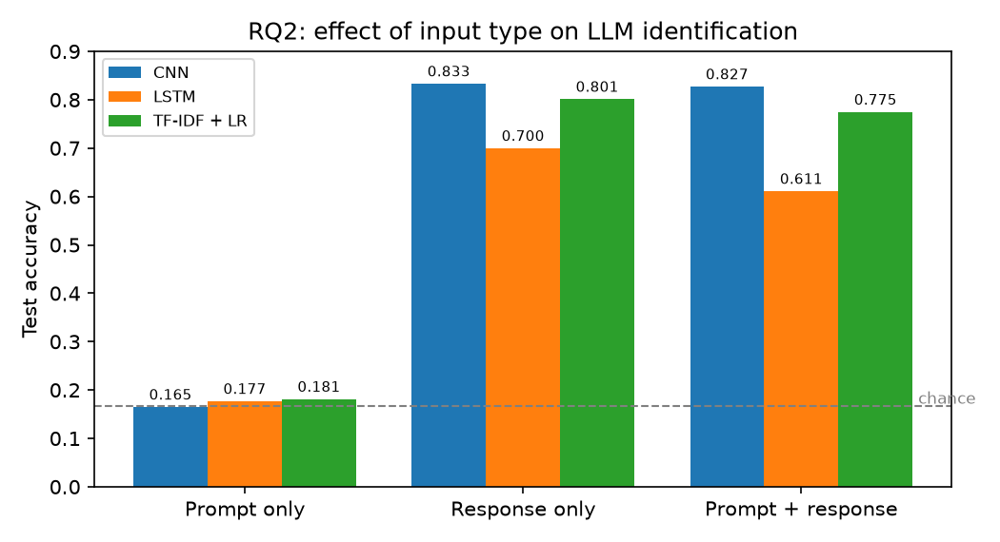
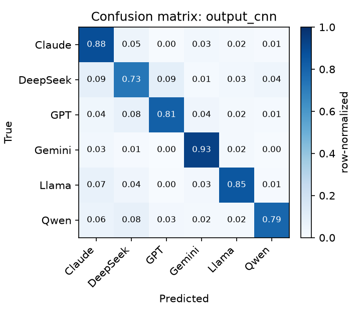
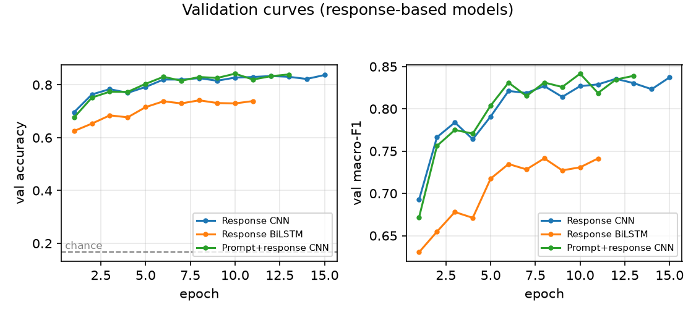
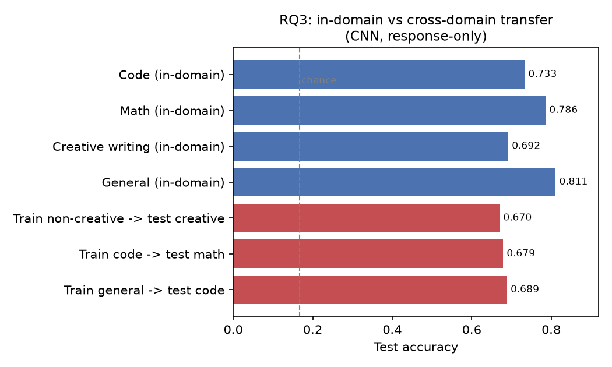
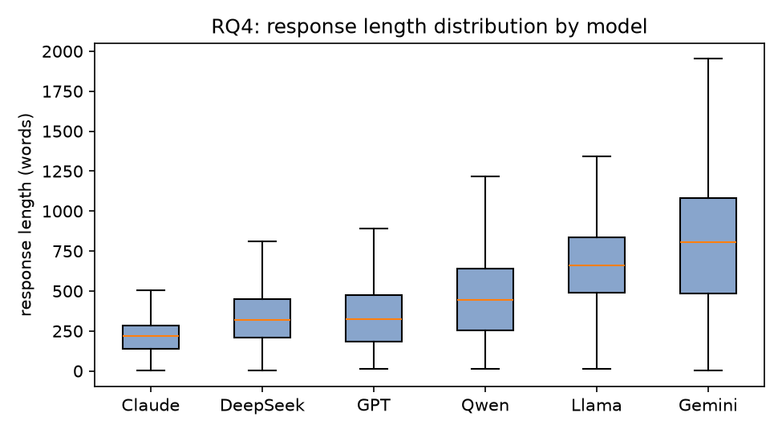
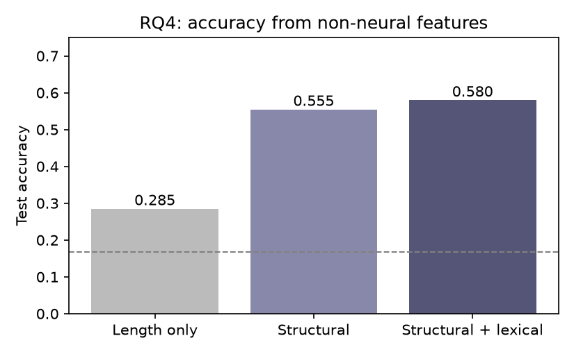

# Who Wrote It? Identifying LLMs from Their Responses

**CMPSC 448: Midterm Project 1**
**Author:** Eric Farrall (individual project)

---

## 1. Problem Definition and Dataset Curation

### 1.1 Problem

Large language models leave stylistic fingerprints in their text. We frame
the problem as a supervised **6-way text classification** task: given a piece
of text (and optionally the prompt that produced it), predict which LLM
family generated the response. We address:

- **RQ1:** Can we identify which LLM generated a response, using the
  response text alone?
- **RQ2:** Does the user's prompt help identify the LLM? We compare
  prompt-only, response-only, and prompt+response classifiers.
- **RQ3 (extra credit):** Do fingerprints generalize across tasks/domains?
- **RQ4 (extra credit):** What structural/linguistic characteristics
  distinguish the models?

### 1.2 Data source and how it was collected

We use **`lmarena-ai/arena-human-preference-140k`** (Hugging Face, license
**CC-BY-4.0**): 140k real "battles" from the LMArena (Chatbot Arena)
platform in which a human user submitted one prompt and two anonymous LLMs
each answered it, after which the user voted for the better answer. Unlike
synthetic benchmark datasets, these are natural, spontaneously written user
prompts and unrestricted model responses, collected and released publicly
by the LMArena team. We chose it because (a) each row links **one prompt to
two different models**, which is ideal for RQ2 and controls for prompt
content, and (b) it spans many modern models and model families.

### 1.3 Dataset construction

Raw rows are battles of the form
`(model_a, model_b, conversation_a, conversation_b, category_tag, conv_metadata)`.
We transform each battle into individual samples `(model, prompt, response)`:

1. **Download** all 7 parquet shards (1.6 GB) directly from the HF Hub.
2. **Flatten**: each battle yields 2 samples (side a and side b).
3. **Keep** English, first-turn, text-only conversations with a non-empty
   user message and assistant reply (images and multi-turn contexts are
   outside our text-only scope).
4. **Filter** prompts < 5 characters and responses < 100 characters.
5. **Deduplicate** exact `(model, prompt, response)` triples.

From the 142,279 extracted English first-turn samples, we then select
**one representative model per family** and cap each class for balance:

| Family | Model (API name) | Train | Val | Test |
|---|---|---|---|---|
| OpenAI | `gpt-4.1-2025-04-14` | 1050 | 225 | 225 |
| Anthropic | `claude-sonnet-4-20250514` | 1050 | 225 | 225 |
| Google | `gemini-2.5-pro` | 1050 | 225 | 225 |
| Alibaba | `qwen3-235b-a22b-no-thinking` | 1050 | 225 | 225 |
| DeepSeek | `deepseek-v3-0324` | 1050 | 225 | 225 |
| Meta | `llama-4-maverick-03-26-experimental` | 1050 | 225 | 225 |

**Total: 9000 samples** (1500 per class), perfectly balanced.

**Leakage control (important for RQ2).** Arena users frequently re-submit
the same prompt, and one battle produces two samples with identical
prompts. A naive random split would put the same prompt in train and test.
We therefore group samples by the MD5 hash of the normalized prompt and
assign whole groups to train/val/test (70/15/15) using a deterministic hash
bucket. We verified the three splits share **zero** prompt hashes. This
means test prompts are always unseen, which is the honest evaluation setup
for RQ2.

### 1.4 Dataset characteristics relevant to the task

Response length alone varies enormously across models (median words:
Claude 216, DeepSeek 320, GPT 324, Qwen 424, Llama 660, Gemini 810), and
formatting differs (Claude uses almost no Markdown headers/lists, while
Gemini/Llama/DeepSeek use many). These signals are analyzed systematically
in RQ4.

---

## 2. Models and Training Details

### 2.1 Text preprocessing

- **Tokenizer**: lowercase regex tokenizer splitting words `[a-z0-9']+`
  and individual punctuation/markdown characters (`#`, `*`, `-`, ...).
  Keeping punctuation is deliberate: formatting markers are part of the
  fingerprint.
- **Vocabulary**: top 30,000 tokens with frequency ≥ 2, built on the
  training split; special tokens `<pad>`=0, `<unk>`=1, `<sep>`=2.
- **Sequence truncation**: prompt-only 128 tokens; response-only 300
  tokens; prompt+response: prompt truncated to 80 tokens, then `<sep>`,
  then response, whole sequence truncated to 320 tokens.
- **Batching**: padded to the longest sequence in each batch; lengths
  passed to the RNN for `pack_padded_sequence`.

### 2.2 CNN (TextCNN)

- Embedding (dim 64, padding index 0)
- Three parallel 1-D convolutions with kernel sizes 3, 4, 5; 128 filters
  each; ReLU
- Global max pooling over time, concatenation (384 features)
- Dropout 0.3 → fully connected layer → 6 logits
- ~2.02M parameters

### 2.3 RNN (BiLSTM)

- Embedding (dim 64)
- Bidirectional LSTM, hidden size 128 per direction, on packed sequences
- Final forward + backward hidden states concatenated (256)
- Dropout 0.3 → fully connected layer → 6 logits
- ~2.1M parameters

### 2.4 Training protocol (identical for every configuration)

| Setting | Value |
|---|---|
| Optimizer | Adam, lr = 1e-3 |
| Batch size | 64 |
| Loss | Cross-entropy |
| Grad clipping | 1.0 |
| Max epochs | 15 |
| Early stopping | patience 3 on validation macro-F1 |
| Seed | 448 (Python, NumPy, PyTorch) |
| Hardware | CPU only (no GPU), PyTorch 2.14.1, 20 threads |

The same protocol is run for all 6 combinations of
{input, output, combined} × {CNN, LSTM}; only the token sequence changes.
Model selection uses validation macro-F1; the test set is touched once at
the end. Predictions, per-class reports, and confusion matrices are saved
as JSON for reproducibility.

### 2.5 Classical baseline (additional classifier)

To place the neural results in context we also trained a non-neural
baseline: TF-IDF features (word 1-2 grams, min document frequency 2, up to
50k features, sublinear term frequency) with a logistic-regression
classifier (C = 4), using the same three input settings and the same
splits. This is the classic strong baseline for text classification and
costs seconds to train.

---

## 3. Results

### 3.1 RQ1 + RQ2 {#rq1rq2}

All configurations were trained under the identical protocol of
Section 2.4. Test-set results (1350 samples with unseen prompts, chance =
1/6 ≈ 0.167):

| Input | Model | Test accuracy | Macro-F1 | Best epoch |
|---|---|---|---|---|
| Prompt only | CNN | 0.165 | 0.152 | 4 |
| Prompt only | BiLSTM | 0.177 | 0.176 | 11 |
| Prompt only | TF-IDF + LR | 0.182 | 0.181 | n/a |
| Response only | CNN | **0.833** | **0.833** | 15 |
| Response only | BiLSTM | 0.700 | 0.700 | 8 |
| Response only | TF-IDF + LR | 0.802 | 0.801 | n/a |
| Prompt + response | CNN | 0.827 | 0.827 | 10 |
| Prompt + response | BiLSTM | 0.611 | 0.610 | 14 |
| Prompt + response | TF-IDF + LR | 0.775 | 0.774 | n/a |

*("Best epoch" is not applicable for the TF-IDF + LR baseline: it is fitted
in one shot by scikit-learn, with no epoch-based training.)*



**RQ1 (response-only identification).** Both required architectures learn
real fingerprints: the CNN reaches **83.3%** accuracy and the BiLSTM 70.0%,
compared to the 16.7% chance baseline. The CNN wins by 13 points. This
intuitively makes sense, as much of the difference between LLMs may lie in
their output style. This style is likely easily detectable with the CNN's
filters, while the BiLSTM needs to compress the entire document into one
hidden state. A classical TF-IDF + logistic-regression baseline reaches
80.2% without any neural machinery, a reminder that surface-level style
statistics already carry most of the signal.

**RQ2 (does the prompt help?).**

- *Input only.* All three model families sit at chance (16.5% / 17.7% /
  18.2%; the spread is within ~1.5 standard errors of 16.7%). The prompt
  genuinely carries no information about which of the two combatants
  produced the reply. This is expected as in this dataset the same prompt
  is answered by two different models. To better answer this question,
  it may be good to locate a dataset where users select their own models.
  Since different groups of people use different models, this may express
  itself in the prompts written.
- *Output only vs input + output.* Adding the prompt to the response never
  helps and sometimes hurts: the CNN stays flat (0.833 → 0.827, within
  noise), the TF-IDF baseline drops slightly (0.802 → 0.775), and the
  BiLSTM drops sharply (0.700 → 0.611). This is a second, independent
  confirmation of the input-only result. The BiLSTM's sensitivity is
  explainable: an 80-token irrelevant prefix changes the recurrent state
  trajectory before any response tokens are read, while CNN max-pooling is
  nearly insensitive to where the style markers appear.
- *Why might input-only work "surprisingly well"?* It does not here.
  Inputs may hold information if users are allowed to self select the
  LLMs they use.

A methodological note: because identical prompts appear with two different
labels (side a / side b), we never let the same prompt cross the
train/test boundary; otherwise the input-only classifier could memorize
prompts rather than learn anything generalizable.

### 3.2 What the errors look like



Per-class test accuracy for the response-only models:

| Model | CNN | BiLSTM |
|---|---|---|
| Gemini | 0.933 | 0.862 |
| Claude | 0.884 | 0.747 |
| Llama | 0.849 | 0.773 |
| GPT | 0.813 | 0.698 |
| Qwen | 0.791 | 0.529 |
| DeepSeek | 0.729 | 0.591 |

Gemini is the easiest model for both architectures, and both models find
DeepSeek hardest. For the CNN, DeepSeek's errors split between GPT (21 cases) and
Claude (20 cases). The DeepSeek/GPT/Qwen middle group writes similarly formatted
answers (Section 4.2), and DeepSeek's replies also drift toward Claude-like
terseness on some prompts. Errors are also uncertain: the mean predicted
probability on misclassified samples is only 0.66, so the classifier rarely
makes confident mistakes. The BiLSTM degrades unevenly: Qwen collapses to
0.53, which is consistent with its weaker overall performance and its tendency to
overfit (training loss 0.14 vs validation loss 0.93 by epoch 11).



One honest caveat: several configurations were still improving when they
hit the epoch cap (the response CNN at epoch 15, the combined-input BiLSTM
at epoch 14), so their numbers are lower bounds, while the response-only
BiLSTM peaked around epoch 8 and then overfit. The CNN/LSTM gap should
therefore be read as "at least 13 points" rather than a converged
comparison.

---

## 4. In-depth Analyses (Extra Credit)

### 4.1 RQ3: Cross-task generalization

We defined four disjoint task domains using the dataset's own annotation
flags: **code** (`is_code`), **math**, **creative writing**, and
**general** (none of the above), and trained Response-only CNNs on one
domain distribution and tested on another, always keeping the global
prompt-group split so no prompt is ever shared between train and test.

Results (CNN, response-only, trained on the "train" domain and tested on
the "test" domain; ~270-360 test samples per experiment, i.e. roughly
45-60 per class, so small per-class differences should not be
over-interpreted):

| Experiment | Test accuracy | Macro-F1 |
|---|---|---|
| Code (in-domain) | 0.733 | 0.736 |
| Math (in-domain) | 0.786 | 0.776 |
| Creative writing (in-domain) | 0.692 | 0.688 |
| General (in-domain) | 0.811 | 0.810 |
| Train non-creative → test creative | 0.670 | 0.663 |
| Train code → test math | 0.679 | 0.655 |
| Train general → test code | 0.689 | 0.670 |



**i) Does performance decrease on unseen tasks?** Yes, but modestly: the
largest gap is code→math (−10.7 points versus in-domain math), while
general→code loses only 4.4 and non-creative→creative loses 2.2 points.
All transfer results remain far above chance (16.7%), so the classifier
learns a substantial domain-independent fingerprint rather than task
memorization.

**ii) Are some models more consistently identifiable across domains?**
Yes. Per-class accuracy across the three transfer tests:

| Model | non-creative → creative | code → math | general → code |
|---|---|---|---|
| Gemini | 0.73 | 0.88 | 0.90 |
| Llama | 0.70 | 0.65 | 0.88 |
| Qwen | 0.59 | 0.79 | 0.93 |
| Claude | 1.00 | 0.80 | 0.48 |
| GPT | 0.57 | 0.34 | 0.63 |
| DeepSeek | 0.47 | 0.53 | 0.30 |

Gemini is the most consistently identifiable model in every domain
(0.73-0.90): its extreme response length and formatting style survive the
task change. Claude is fascinating in both directions: 100% identifiable
on creative writing (its short, unformatted style is unique among story
generators) but only 48% on code, where telling Claude apart from other
terse code answers becomes hard. DeepSeek is consistently the hardest
(0.30-0.53). Its style is the most "generic".

**iii) A general fingerprint or task-specific patterns?** Both. If style
were purely task-specific, cross-task accuracy would collapse to chance; if
purely general, transfer would match in-domain accuracy. The observed
4-11 point drops indicate that the models mix a stable stylistic signature
(length/formatting habits) with task-dependent regularities (e.g. how each
model formats code blocks or math derivations).

### 4.2 RQ4: What distinguishes the models?

First, descriptive statistics (median values per model over the training
split):

| Model | Words | Tokens | Headers | UL items | Bold marks | TTR (200w) |
|---|---|---|---|---|---|---|
| Claude | 216 | 313 | 0 | 0 | 3 | 0.66 |
| DeepSeek | 320 | 626 | 5 | 10 | 16 | 0.62 |
| GPT | 324 | 589 | 5 | 9 | 14 | 0.60 |
| Qwen | 424 | 785 | 6 | 11 | 14 | 0.66 |
| Llama | 660 | 1235 | 0 | 13 | 31 | 0.63 |
| Gemini | 810 | 1289 | 5 | 12 | 23 | 0.62 |



The models separate into three styles: **Claude** is terse and almost
unformatted (median 216 words, zero headers, zero list items), the
**DeepSeek/GPT/Qwen** middle group writes moderately long, heavily
formatted answers, and **Gemini/Llama** respond 2-4x longer than Claude with
the heaviest formatting (10-13 bullet items, 23-31 bold runs). Lexical
diversity (type-token ratio) is nearly identical across models (0.60-0.66),
so the fingerprint is much more *structural* than *lexical*.

Second, how far do non-neural signals get? Note that this is a different
baseline from the TF-IDF + LR model of Section 3.1: here the classifier
never sees the words themselves, only twelve hand-crafted summary numbers
per response (length, formatting counts, and the lexical rates above).
Logistic-regression classifiers on the same grouped splits:

| Features | Test accuracy | Macro-F1 |
|---|---|---|
| Length only (log word count) | 0.285 | 0.236 |
| Structural (length, tokens, headers, lists, bold) | 0.555 | 0.541 |
| Structural + lexical (TTR, word length, punctuation rates) | 0.580 | 0.570 |
| Response-only CNN (reference) | 0.833 | 0.833 |



Response length alone already reaches 28.5% (70% above chance), and simple
formatting counts reach 58%, about 70% of the neural model's accuracy.
Lexical features add only ~2.5 points. This supports the
"structural fingerprint" picture: the CNN's advantage over the metadata
baselines must come from *where and how* the formatting is used (e.g.
## headings vs bold-led sentences, sentence rhythm), not merely from how
much formatting is present.

Third, the TF-IDF + logistic-regression baseline (Section 2.5) gives a
directly interpretable view of which *phrases* identify each model: because
the model is linear, its largest per-class feature weights are readable.
The highest-weighted 1-2 gram features per class (learned on the training
split, all lowercase):

| Class | Highest-weight 1-2 grams |
|---|---|
| Claude | `that`, `rather than`, `typically`, `rather`, `through` |
| DeepSeek | `would you`, `you like`, `would`, `key`, `but` |
| GPT | `summary`, `certainly`, `summary table`, `absolutely`, `you want` |
| Gemini | `of course`, `course`, `this is`, `here is`, `is the` |
| Llama | `now`, `ll`, `happy`, `here the`, `question` |
| Qwen | `know if`, `you like`, `like`, `sure`, `me know` |

The baseline essentially rediscovers each model's conversation-level verbal
tics: GPT's "Certainly!"/"Absolutely!" and "in summary" wrappers, Gemini's
"Of course!", Qwen's "Sure, let me...", Llama's "Now go..." and "Happy to
help". Several of the strongest cues are phrasal rather than single words
(`in summary`, `would you`, `let me`, `you like`), which matches the CNN's
design: n-gram filters detect exactly this kind of multi-word habit. The
idf weighting also explains why the baseline is strong despite being
linear. Distinctive words dominate common ones (idf: `the` 1.08,
`excellent` 3.45, `certainly` 4.17), so the classifier automatically
focuses on style rather than topic. Note, however, that TF-IDF sees only
word tokens (punctuation and Markdown marks are dropped by its default
tokenizer), so it cannot use the formatting signals quantified above; this
is part of why the CNN still wins by ~3 points.

Fourth, an ablation isolates length: the response-only CNN was retrained
with all responses truncated to the first 128 tokens (the median response
is ~780 tokens and 94% of responses exceed 128 tokens, so the length
signal is destroyed for nearly every sample). Accuracy falls
from 0.833 to 0.792 (−4.1 points). The model
keeps 95% of its accuracy, meaning the fingerprint lives mostly in *what
the text looks like* in the first ~800 words (vocabulary, formatting
choices, sentence rhythm), with length as an additional but secondary
cue.

Caveats: the formatting styles are partly an artifact of each vendor's
default chat template and system prompt, not necessarily "intrinsic"
linguistic fingerprints. A fairer follow-up would re-measure with
formatting stripped and lengths equalized.

---

## 5. Lessons and Experience

<!-- EDIT/REWRITE in your own voice before submitting -->

- **Data leakage is easy to miss.** The most valuable habit from this
  project was checking whether the same prompt appeared in train and test.
  Arena users resubmit the same questions constantly, and one battle
  produces two samples with identical prompts; a random split would have
  inflated every RQ2 number.
- **Negative results are results.** "The prompt does not identify the
  model" (16.5-18.2% vs 16.7% chance across three model families) is only
  credible because the same pipeline achieves 83% from the response;
  reporting input-only without that control would have meant nothing.
- **Architecture matters less than representation.** The CNN beat the
  BiLSTM by 13 points on identical tokens, mostly, we suspect, because
  max-pooling over n-gram detectors does not have to summarize a whole
  document into one vector. The non-neural baselines (58% from six
  metadata columns) further showed that a large share of the signal is
  simple structure, not deep semantics.
- **Respect the compute budget.** With no GPU, a single BiLSTM epoch on
  300-token sequences costs ~15 minutes. Choosing sequence lengths,
  model size, and the number of configurations *before* launching runs is
  part of the experiment design, not an afterthought; we checkpointed each
  run so a long sweep could resume after interruption.
- **Measurement discipline.** Fixing the seed, keeping one protocol across
  all six configurations, selecting models on validation macro-F1, and
  touching the test set only once were small habits that made the
  comparisons trustworthy.
- **Tooling.** Development was assisted by an AI coding agent (opencode);
  all code, data decisions, and results were reviewed, run, and verified by the me (Eric Farrall).

---

## 6. Reproducibility

Repository layout:

```
src/build_dataset.py   download + flatten LMArena shards
src/make_splits.py     class selection, balance, leakage-free splits
src/textdata.py        tokenizer, vocabulary, Dataset/collate
src/models.py          TextCNN and BiLSTM definitions
src/train.py           training/evaluation for one configuration
src/run_all.sh         runs the 6 RQ1/RQ2 configurations
src/tfidf_baseline.py  TF-IDF + logistic-regression baseline
src/rq3_transfer.py    RQ3 domain-transfer subsets
src/rq4_analysis.py    RQ4 feature analysis + non-neural classifiers
src/make_figures.py    report figures
results/               metrics, predictions, models (JSON/parquet)
```

Run `src/build_dataset.py` → `src/make_splits.py` → `src/run_all.sh` to
reproduce the main results; `src/rq3_transfer.py`, `src/rq4_analysis.py`,
`src/make_figures.py` reproduce the extra-credit analyses. Raw data is not
redistributed in the repo; it is downloaded from the public HF dataset.
